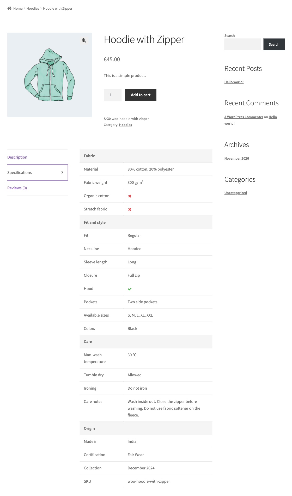

# Product Specifications & Compare for WooCommerce

> [!IMPORTANT]
> **Upgrading from 0.x?** Version 2 stores specifications in a new format.
> Your specification tables are hidden from the storefront until you run the migration
> under **WooCommerce → Product Specifications → Migration**. Back up your database first
> and read the [migration guide](docs/site/guide/upgrading.md) before you update.

Show a clear specifications table on your WooCommerce products, and let shoppers compare
products side by side. Define each specification once, group specifications into a set for
each kind of product, and fill in the values on the product screen. The table shows in a
product tab, a block and the `[specs-table]` shortcode. A Compare button on each product
opens a comparison page where shoppers line up products of the same kind.

The plugin is available on [WordPress.org](https://wordpress.org/plugins/product-specifications/).

[](https://playground.wordpress.net/?blueprint-url=https://raw.githubusercontent.com/dornaweb/product-specifications/develop/.wordpress-org/blueprints/blueprint.json)

The demo opens a WooCommerce store with sample products, three specification sets and filled-in specification tables, logged in as admin.



## Features

- A reusable library of specifications, each usable in any number of sets.
- Specification types: text, paragraph, single select, yes or no, number with units and
  ranges, document, link, date, and WooCommerce product data such as weight, dimensions,
  SKU, brand or attributes.
- A drag-and-drop set editor with groups.
- A product panel that enters each value with the control its type needs.
- The table in a product tab, a block, or anywhere with the `[specs-table]` shortcode.
- Product comparison: a Compare button, a comparison page that lines up products of the
  same set, and a shareable link, with blocks and shortcodes to place both anywhere.
- Import and export of specifications, sets and product values, also from WP-CLI.
- A PHP API, hooks and custom specification types for developers.

## Documentation

- [User guide](docs/site/README.md): getting started, specifications, sets, products, the storefront and product comparison.
- [Developer documentation](docs/site/developers/index.md): the PHP API, hooks and custom types.
- [Upgrading from 0.x](docs/site/guide/upgrading.md)

## Translation

Help translate the plugin on [translate.wordpress.org](https://translate.wordpress.org/projects/wp-plugins/product-specifications/).

## Development

Requires PHP 8.1, Composer, Node.js and Docker.

```bash
composer install
npm ci
npx @wordpress/env start     # http://localhost:8888, WooCommerce installed
npm run start                # watch the admin and block assets
```

Checks:

```bash
composer phpstan
vendor/bin/phpcs
vendor/bin/phpunit
npm run lint:js
npm run typecheck
npm run test:js
npm run test:e2e
```

## Donation

Donations are happily appreciated, if you find this work useful, you can donate any amount via one of the following ways:

- [Donate via Paypal](https://www.paypal.com/donate/?hosted_button_id=W7GUT6CFS5PVA)
- Cryptocurrency: `0x90B0f45e24C6942594Ad0a6cfcf23860F83623bA` (Ethereum network)

<a href="https://www.buymeacoffee.com/amiut" target="_blank"></a>

## Changelog

[See changelog for all versions](changelog.txt).
