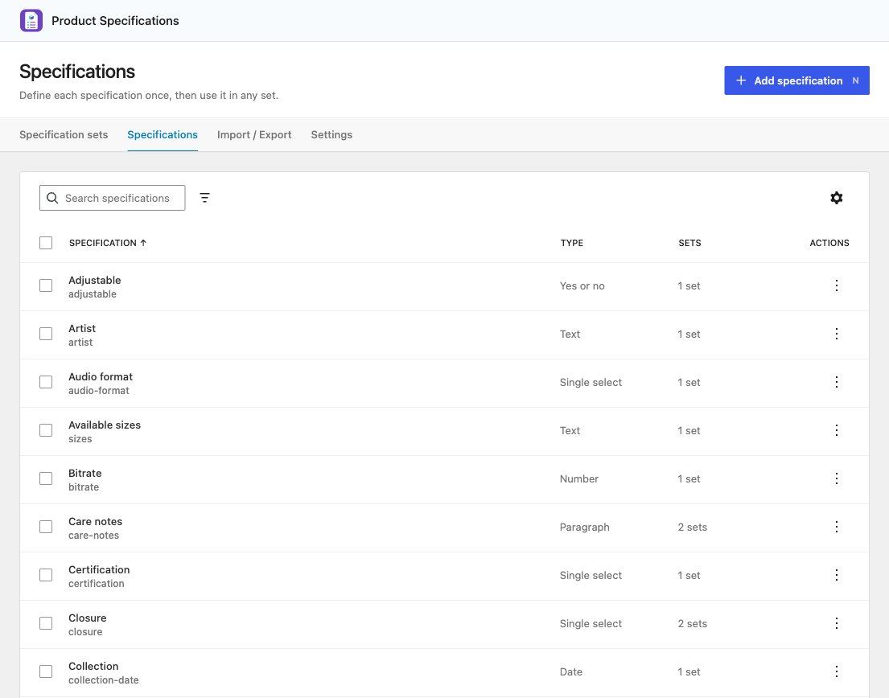
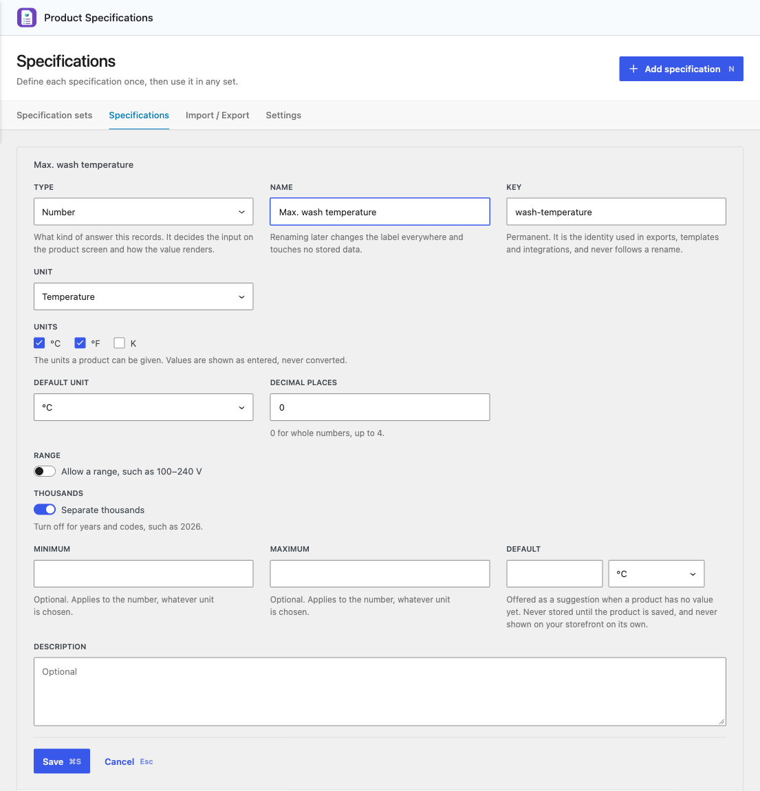

# Specifications

A specification is one thing you describe about a product, such as *Processor*,
*Screen size* or *Warranty*. You define it once and use it in as many
[sets](./sets.md) as you like.

Specifications live under **WooCommerce → Product Specifications → Specifications**.

The list shows each specification's type and how many sets use it. Search by name, and
filter by type.

## Add a specification

Click **Add specification**, or press <kbd>N</kbd>.

| Field | What it does |
| --- | --- |
| **Type** | What kind of answer this records. It decides the input on the product screen and how the value renders. See [Specification types](./types.md). |
| **Name** | The label shown in the admin and on your storefront. Renaming later changes the label everywhere and touches no stored data. |
| **Default** | Offered as a suggestion when a product has no value yet. It is never stored until the product is saved, and never shown on your storefront on its own. |
| **Description** | Optional, for your own reference. |

Other fields depend on the type, such as the units of a Number or the options of a
Single select.

### Adding many in a row

**Save and add another** (<kbd>⌘</kbd>/<kbd>Ctrl</kbd> + <kbd>Enter</kbd>) saves and
opens a new, empty form, so you can enter a whole list from the keyboard. **Save and
close** (<kbd>⌘</kbd>/<kbd>Ctrl</kbd> + <kbd>S</kbd>) saves and closes the form, and
<kbd>Esc</kbd> cancels.

## The specification key

Every specification has a key, shown under its name in the list, such as `screen-size`.
Developers use it to read and write values, and imports use it to match specifications
between stores.

The key is chosen when you create the specification. The form fills it in from the name
and keeps following the name until you edit it. If another specification already has
that key, the form says which one and offers the next free key, such as `screen-size-2`,
with one click. A key cannot be a whole number.

After the first save the key is permanent. Renaming the specification changes its label
everywhere and leaves the key as it is.

## Changing a specification

Open a specification's **⋮** menu and click **Edit**. A new name or default applies everywhere at once. A
value a product already has is kept when you change options such as the minimum of a
Number: the new rules apply the next time that value is changed.

Changing the **type** can make existing values unreadable, for example when a Text
specification becomes a Number. Those values stay stored and show as unreadable on the
product screen. Nothing is deleted, and changing the type back restores them.

## Deleting a specification

Before you delete a specification, the plugin shows which sets use it and how many
products hold a value for it. Deleting removes it from those sets and removes its value
from every product. Deleting cannot be undone.

When more than a couple of hundred products hold a value, the removal continues in the
background after the deletion, and the Specifications screen shows its progress. Until it
has finished, the key cannot be given to a new specification. On a site whose scheduled
tasks never run, `wp product-specifications purge run` finishes the removal from the
command line.
